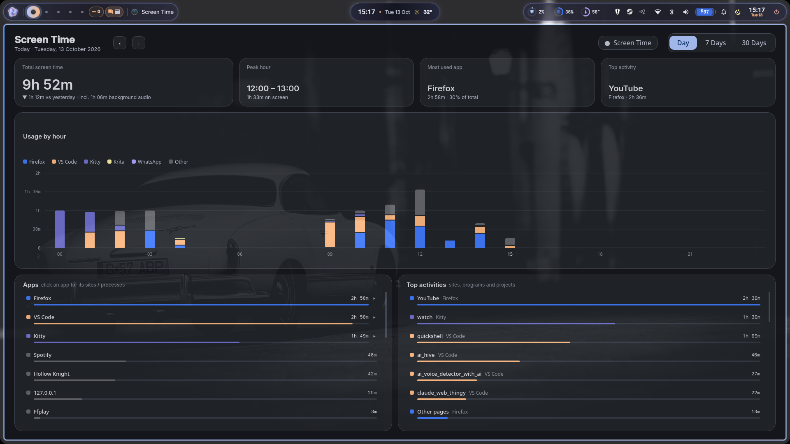

# Hyprland screen time



- `tracker.py`: a daemon that samples the focused Hyprland client once a second and adds the time to `usage.json` in this folder. If Hyprland isn't running (`hyprctl clients` fails), it waits quietly and starts tracking once Hyprland is up. When Hyprland exits, it saves and waits for the next session.
- `gui.py`: a PySide6 dashboard with Day, 7 Days and 30 Days views.

## What gets counted

- **Apps playing audio count too**, even when they're not focused, e.g. YouTube on another workspace or music in a terminal. Each stream is traced to its window through its process (`pactl`), Firefox and Chromium don't say which tab is playing, so a browser's audio goes to the window showing a known site (YouTube, Anikoto, ...), or to the browser with no detail. Paused, muted and 0% volume streams don't count, and neither does anything while the screen is locked or off. This time is stored in a separate `audio` section of `usage.json` and added to each app's time. Turn it off with `"count_audio": false`.
- **Screen time never double-counts.** Watching a video while you work counts for both apps, so app times can add up to more than the clock. The tracker also records real screen time (each second once, in `active`). That's what the main total, the bar heights and the averages show, so no hour goes above 1h. Where apps overlap, a small note says what they add up to ("Apps add up to 2h 49m"). Hours from before this record existed (before 26 Oct 2026) are estimated from focus time and marked "estimated".
- **Otherwise only the focused window counts.** Anything sitting in `special:minimize`, `special:network_social` or any other special workspace counts only while that special workspace is open and the app has focus.
- **Each app gets a detail:**
  - Browsers: the site, taken from the tab title (YouTube, Anikoto, GitHub, ...). Add your own rules with `extra_sites` in `config.json`.
  - Terminals: the foreground program, taken from `/proc` (nvim, btop, claude, ...).
  - Editors: the project folder.
  - mpv and vlc: the file that is playing.
  - Chromium `--app=` windows such as WhatsApp count as their own app.
- **Paused while** a screen locker (hyprlock, swaylock, gtklock, waylock) is running, all screens are off (DPMS), or no window is focused.
- **Idle time is removed.** When hypridle locks the screen after 240 s without input, those 240 s of idle time are taken off again. The timeout is read from `hypridle.conf`.
- **Old data is pruned.** Data older than 30 days (`retention_days`) is deleted automatically.

## Run

```sh
./tracker.py            # daemon (refuses to start twice)
./tracker.py --once     # show how the current window would be classified
./gui.py                # dashboard
```

Keys in the GUI:

- `1`, `2`, `3` switch views.
- `←` and `→` step through days or weeks.
- `q` or `Esc` closes the window.

Click a day's column in the 7 Days or 30 Days chart to open that day.

**Colours follow your wallpaper**, in light and dark mode. The GUI reads the first palette it finds: `theme_files` in `config.json`, then the Prism shell's `~/.config/quickshell/.state/palette.json`, then pywal's `~/.cache/wal/colors.json`. It recolours live when the wallpaper changes. Each app gets the same colour as in Prism's Screen time tab, unless that colour is too close to one already on the chart; then it gets the next distinct one, falling back to a colour-blind-safe set.

## Install

```sh
./install.sh            # user service + launcher entry, no sudo
./install.sh --system   # system service that runs as you (what Jack uses)
./install.sh --help     # other options: --deps, --no-gui, --dry-run, --uninstall ...
```

It checks python3, hyprctl, pactl and PySide6, and offers to install what's missing (pacman, apt, dnf, zypper, xbps, apk, emerge). It writes the service and launcher entry with this folder's path, so re-run it if you move the folder. Without systemd it prints an `exec-once` line for your Hyprland config.

- **Always restarts.** `Restart=always` with no limit on retries, so it comes back after a crash, a kill or even a clean exit. Only `systemctl stop` keeps it down.
- **Waits instead of quitting.** It waits for you to log in and for Hyprland to start, and survives logouts.
- **Never runs twice.** A second tracker waits for the first to exit instead of running alongside it.

To see its output: `journalctl -u hypr-screentime -f` (add `--user` for the user service).

